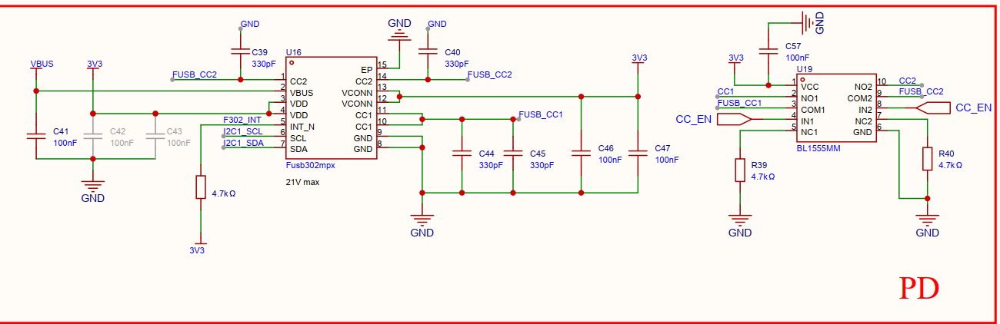
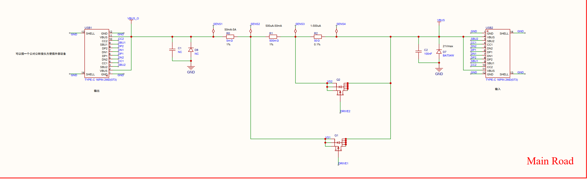

## 从复刻 Power-Pico 说起

最近我在复刻油炸鸡的 Power-Pico。它是一台支持微安级测量的 USB-C 电流计，也能通过 PPS 让充电器输出指定电压，用作简易可调电源。我沿用了原作者的硬件设计。第一次接触 PPS 时，我想弄清楚一个问题：在板子上选好电压之后，充电器是怎么知道该输出多少伏的？这篇文章就沿着原理图上的两条路径来找答案，一条是传递协商消息的 CC 线，另一条是给负载供电的 VBUS 主回路。[Power-Pico 开源仓库](https://github.com/No-Chicken/Power-Pico)

「PPS 诱骗」是对这类用法的俗称。Power-Pico 在协商中扮演受电端（Sink），通过 USB-C 的 CC 线向供电端（Source）发送请求。充电器接受请求后调节自己的 VBUS 输出。[USB-IF USB Power Delivery 技术介绍](https://www.usb.org/sites/default/files/D2T2-1%20-%20USB%20Power%20Delivery.pdf#page=15)

## 固定档和 PPS 有什么区别

| 供电方式 | 充电器公布什么 | 受电端怎样选择 |
| --- | --- | --- |
| SPR 固定电压档（Fixed PDO） | 每档一个固定电压以及该档的电流能力，常见档位有 5、9、15 和 20 V | 从实际公布的档位中选择一档 |
| SPR PPS（PPS APDO） | 每档的可调电压范围和电流能力 | 选择 PPS APDO，在允许范围内请求目标电压和工作电流 |
| EPR 固定档和 EPR AVS | EPR 增加了 28、36、48 V 固定档，以及可调电压的 EPR AVS 能力 | 在整条供电链路支持 EPR，并进入 EPR 模式后，按供电端公布的能力请求 |

SPR 是标准功率范围，EPR 是扩展功率范围。PPS 是 SPR 中的一种可编程供电能力。高电压 PPS 档的可编程上限可到 21 V，具体电压范围和电流条件要看充电器当前端口公布的 APDO，也要满足线缆和板子的额定条件。[USB-IF PPS 电压范围](https://www.usb.org/sites/default/files/D2T2-1%20-%20USB%20Power%20Delivery.pdf#page=15) · [USB-IF EPR 简介](https://www.usb.org/usb-charger-pd)

PPS 的 `Request` 消息带有一个 RDO（Request Data Object），其中的对象位置指向所选的 APDO。请求的电压以 **20 mV** 为单位编码，工作电流以 **50 mA** 为单位编码。假设充电器公布了 `3.3–11.0 V / 3.0 A` 的 PPS 档，受电端请求 `8.60 V / 2.00 A`，这两个字段的值分别是 `8600 ÷ 20 = 430` 和 `2000 ÷ 50 = 40`。其中 `2.00 A` 是请求的工作电流，实际电流由负载决定。[USB-IF PPS 工作区与请求单位](https://www.usb.org/sites/default/files/D2T2-1%20-%20USB%20Power%20Delivery.pdf#page=41)

## Power-Pico 如何用 FUSB302MPX 做 PPS 协商

### CC 路径负责通信

*图 1　FUSB302MPX 的 I²C、IRQ 接口和 `CC_EN` 控制的 CC 切换。图源为 [Power-Pico 硬件设计](https://oshwhub.com/no_chicken/powerpico)。*

图 1 左边的 FUSB302MPX（U16）负责检测 CC 连接，并在有效的 CC 线上收发 PD 消息。主控通过 `I2C1_SCL` 和 `I2C1_SDA` 配置芯片、读写消息，通过 `F302_INT` 获知事件。请求哪个档位、填入多少电压和电流，以及何时重发，交给主控固件决定。[onsemi FUSB302 数据手册](https://www.onsemi.com/download/data-sheet/pdf/fusb302-d.pdf) · [Power-Pico PD 固件](https://github.com/No-Chicken/Power-Pico/blob/741cf34f88b4aac637775a6153b829dbba31ea03/software/Power_Pico/BSP/PD/fusb302_dev.c)

图 1 右边的 BL1555MM（U19）是双路模拟开关。原理图把 `CC_EN` 同时接到两路控制端。`CC_EN` 为高时，开关把控制器侧的 `FUSB_CC1/2` 接到接口侧的 `CC1/2`。`CC_EN` 为低时，控制器侧切到各自的 `4.7 kΩ` 对地支路，与接口侧的 CC 网络分离。沿图 2 的同名网络往下找，还能看到输入口 USB2 和输出口 USB1 共用接口侧的 `CC1/2`。[上海贝岭 BL1555 数据手册](https://www.belling.com.cn/media/file_object/bel_product/BL1555/datasheet/BL1555_V1.1_en.pdf)

### VBUS 主回路负责供电和电流测量

*图 2　右侧 USB2 是输入，左侧 USB1 是输出，中间是分档电流采样主回路。图源为 [Power-Pico 硬件设计](https://oshwhub.com/no_chicken/powerpico)。*

供电从右侧 USB2 的 `VBUS` 进入，经过电流采样主回路，再由左侧 USB1 的 `VBUS_O` 输出。`R0`、`R1`、`R2` 是采样电阻，`Q1` 和 `Q2` 用来旁路其中的部分电阻，以适应不同电流量程。带载验证时可以同时测输入端与输出端，观察压降出现在充电器到板子的连接上，还是在板上的采样回路及输出侧。[Power-Pico 硬件原理](https://no-chicken.com/content/Power-Pico/WorkingPrinciple/hardware_detail.html)

## 从请求到 VBUS 改变，抓包看哪些消息

| 方向 | 消息 | 核对内容 |
| --- | --- | --- |
| 充电器 → Power-Pico | `Source_Capabilities` | 当前端口公布了哪些固定档和 PPS APDO |
| Power-Pico → 充电器 | `Request` | RDO 的对象位置、请求电压和工作电流 |
| 充电器 → Power-Pico | `Accept` | 充电器已接受请求 |
| 充电器 → Power-Pico | `PS_RDY` | 充电器报告电源切换完成，可与此后的 VBUS 实测值对照 |

表中省略了 `GoodCRC` 等确认消息。看抓包时，先把 `Request` 中的对象位置和前面公布的 PPS APDO 对上，再找对应的 `PS_RDY`。Power-Pico 的公开固件在收到 `PS_RDY` 后根据所选档位更新状态。进入 PPS 模式后，示例源码会按约 5 秒的间隔重发 `Request`，即使设定值没变也继续维持 PPS 合约。[USB-IF 电源转换时序](https://www.usb.org/sites/default/files/D2T2-1%20-%20USB%20Power%20Delivery.pdf#page=35) · [Power-Pico PPS 定时请求实现](https://github.com/No-Chicken/Power-Pico/blob/741cf34f88b4aac637775a6153b829dbba31ea03/software/Power_Pico/BSP/PD/fusb302_dev.c#L146-L179)

## 怎么上板测量

台架可以按「充电器 → USB-C 线缆 → Power-Pico 输入口 USB2 → 输出口 USB1 → 电子负载」连接。先让负载保持关闭，在充电器、线缆、板子和负载的额定范围内选择一个请求点，用万用表确认输出端的电压与极性。再从小负载开始，逐步增加负载，记录请求值、输入和输出的实测电压以及负载电流。有 PD 分析仪时，可以一起记录 APDO、`Request` 和 `PS_RDY`，用来区分协议协商和供电路径上的问题。

| 测试项目 | 建议记录 |
| --- | --- |
| 试验条件 | 充电器型号和实际使用的端口、线缆额定电流、PCB 与固件版本、仪表 |
| 空载调压 | APDO 电压范围、PPS 请求值、`VBUS` 和 `VBUS_O` 实测电压 |
| 带载表现 | 实际负载电流、输入与输出电压、当前采样量程、是否出现重新协商 |
| 连续工作 | 观察时长、是否维持在 PPS 模式、是否有断电或重新协商 |

## 调不出目标电压时，从哪里查

- **只能输出 5 V**。先看 `Source_Capabilities` 里有没有 PPS APDO。没有能力消息时，检查板子是否上电、`CC_EN` 是否切到协议通路，以及 FUSB302 是否识别到有效的 CC 线。有能力消息但没有 `PS_RDY` 时，从 `Request` 的对象位置和请求范围查起。
- **协商成功后又掉回低压**。把掉压时刻与周期性 `Request`、重置消息、负载变化和其他端口的插拔对齐，看看哪件事先发生。
- **空载正常，带载后输出偏低**。在同一负载点分别测量 `VBUS`、`VBUS_O` 和负载端。输入端已下降时，先查充电器输出和输入线缆。压降主要出现在 `VBUS` 和 `VBUS_O` 之间时，重点看采样档位、分流电阻和 MOSFET 旁路状态。

## 参考资料

- [No-Chicken / Power-Pico 开源仓库](https://github.com/No-Chicken/Power-Pico)
- [USB-IF USB Power Delivery 规范与下载](https://www.usb.org/document-library/usb-power-delivery)
- [onsemi FUSB302 数据手册](https://www.onsemi.com/download/data-sheet/pdf/fusb302-d.pdf)
- [上海贝岭 BL1555 数据手册](https://www.belling.com.cn/media/file_object/bel_product/BL1555/datasheet/BL1555_V1.1_en.pdf)
